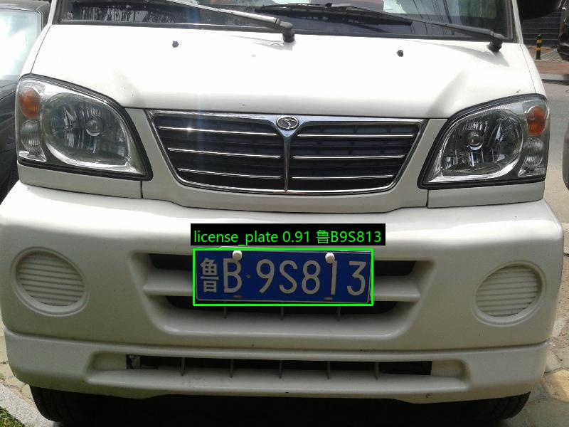

# 中文车牌检测与识别

基于 YOLOv8 和 CRNN + CTC 的中文车牌识别项目。输入一张车辆图片，项目会先定位车牌位置，再裁剪车牌区域并识别完整车牌字符串，最后生成带检测框和识别结果的标注图片。



## 功能特性

- 使用 YOLOv8 训练单类车牌检测模型
- 使用 CRNN + CTC 识别中文车牌字符
- 从 `CLPD.csv` 自动生成 YOLO 检测数据和 OCR 训练数据
- 支持中文图片路径和中文车牌绘制
- 支持训练、验证、测试以及交互式单图推理

## 处理流程

```text
输入图片
   |
   v
YOLOv8 车牌检测
   |
   v
车牌区域裁剪
   |
   v
CRNN 提取序列特征
   |
   v
CTC 解码
   |
   v
车牌字符串 + 标注图片
```

## 项目结构

```text
.
├── 01_prepare_data.py       # 生成 YOLO 检测数据和 OCR 数据
├── 02_train_detect.py       # 训练并评估车牌检测模型
├── 03_train_ocr.py          # 训练并评估 CRNN 车牌识别模型
├── 04_predict_single.py     # 交互式端到端推理
├── common.py                # 路径解析和命令行参数校验
├── ocr_model.py             # CRNN、字符映射和 CTC 解码
├── plate_utils.py           # 图片读写、裁剪和中文标注
├── CLPD.csv                 # 车牌四角点和字符标注
├── samples/                 # 示例图片
└── requirements.txt         # Python 依赖
```

运行时还会生成以下目录：

```text
datasets/                    # 训练数据
datasets/license_plate/      # YOLO 检测数据
datasets/ocr/                # OCR 识别数据
runs/detect/                 # YOLO 训练结果
runs/ocr/                    # OCR 训练结果
outputs/predictions/         # 推理结果
```

## 环境要求

- Python 3.10
- PyTorch 2.5.1
- TorchVision 0.20.1
- Ultralytics
- OpenCV、NumPy、Pillow

建议使用独立虚拟环境：

```powershell
python -m venv .venv
.\.venv\Scripts\activate
```

安装 CUDA 12.1 版 PyTorch：

```powershell
python -m pip install torch==2.5.1 torchvision==0.20.1 --index-url https://download.pytorch.org/whl/cu121
```

如果没有 NVIDIA GPU，也可以安装 CPU 版：

```powershell
python -m pip install torch==2.5.1 torchvision==0.20.1 --index-url https://download.pytorch.org/whl/cpu
```

安装其余依赖：

```powershell
python -m pip install -r requirements.txt
```

## 数据准备

默认数据目录结构如下：

```text
CLPD.csv
CLPD_1200/
├── 0.jpg
├── 1.jpg
└── ...
```

`CLPD.csv` 中每行至少需要包含：

```text
path,x1,y1,x2,y2,x3,y3,x4,y4,label
```

其中 `path` 是图片路径，`x1...y4` 是车牌四个角点，`label` 是车牌字符。

生成训练数据：

```powershell
python 01_prepare_data.py
```

脚本会按 7:2:1 划分训练集、验证集和测试集，并生成：

- `datasets/license_plate/`：YOLO 检测数据
- `datasets/ocr/`：车牌裁剪图和 OCR 标签
- `datasets/ocr/characters.txt`：训练数据对应的字符表
- `skipped_rows.log`：无法处理的 CSV 行

## 模型训练

训练 YOLOv8 检测模型：

```powershell
python 02_train_detect.py --device 0
```

CPU 训练时使用：

```powershell
python 02_train_detect.py --device cpu
```

常用参数：

| 参数 | 默认值 | 说明 |
| --- | --- | --- |
| `--model` | `yolov8n.pt` | 预训练模型 |
| `--epochs` | `100` | 训练轮数 |
| `--batch` | `16` | 批次大小 |
| `--imgsz` | `640` | 输入图片尺寸 |
| `--device` | `0` | 训练设备，CPU 使用 `cpu` |

训练 CRNN 识别模型：

```powershell
python 03_train_ocr.py --device 0
```

CPU 训练时使用：

```powershell
python 03_train_ocr.py --device cpu
```

常用参数：

| 参数 | 默认值 | 说明 |
| --- | --- | --- |
| `--epochs` | `100` | 训练轮数 |
| `--batch` | `64` | 批次大小 |
| `--lr` | `0.001` | 初始学习率 |
| `--width` | `320` | OCR 输入宽度 |
| `--height` | `96` | OCR 输入高度 |
| `--device` | `0` | 训练设备，CPU 使用 `cpu` |

训练完成后默认得到：

```text
runs/detect/license_plate/weights/best.pt
runs/ocr/best.pth
```

## 单图识别

启动交互式推理：

```powershell
python 04_predict_single.py --device cpu
```

程序会循环等待图片路径，输入 `q`、`quit` 或 `exit` 退出：

```text
图片路径: samples/890.jpg
检测到 1 个车牌
检测 1: 坐标=(272,350,523,428), 置信度=0.9139, 车牌=鲁B9S813
结果已保存: outputs/predictions/890_result.jpg
```

也可以显式指定模型权重：

```powershell
python 04_predict_single.py `
  --weights runs/detect/license_plate/weights/best.pt `
  --ocr-weights runs/ocr/best.pth `
  --device cpu
```

常用参数：

| 参数 | 默认值 | 说明 |
| --- | --- | --- |
| `--weights` | `runs/detect/license_plate/weights/best.pt` | YOLO 检测权重 |
| `--ocr-weights` | `runs/ocr/best.pth` | OCR 识别权重 |
| `--conf` | `0.25` | 检测置信度阈值 |
| `--pad` | `0.05` | 裁剪车牌时向外扩展的比例 |
| `--device` | `0` | 推理设备，CPU 使用 `cpu` |
| `--output` | `outputs/predictions` | 结果保存目录 |

## 输出结果

每张输入图片会在输出目录生成一张 `*_result.jpg`，其中包含：

- 绿色车牌检测框
- 检测置信度
- OCR 识别出的车牌字符串

## 数据集和模型文件说明

`CLPD_1200/`、`datasets/`、`runs/`、`outputs/` 以及 `*.pt`、`*.pth` 权重文件不会提交到 Git 仓库，以避免仓库体积过大。克隆项目后需要自行准备数据并完成训练，或将已有权重放到默认路径。

## 当前范围

- 当前数据集主要覆盖单行中文车牌，检测模型只区分“车牌”这一类。
- 识别结果依赖训练字符表，字符表之外的字符无法正确输出。
- 倾斜角度很大的车牌目前使用水平外接框裁剪，没有进行透视矫正。
